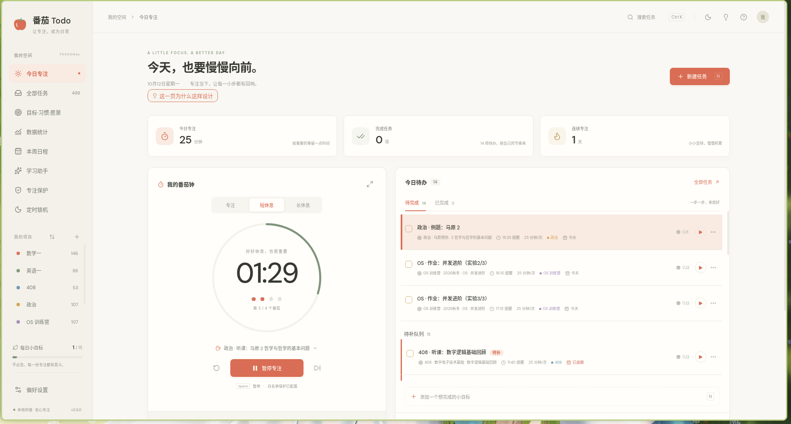
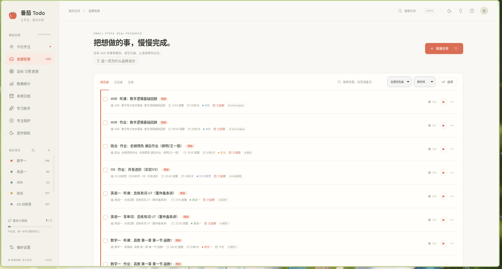
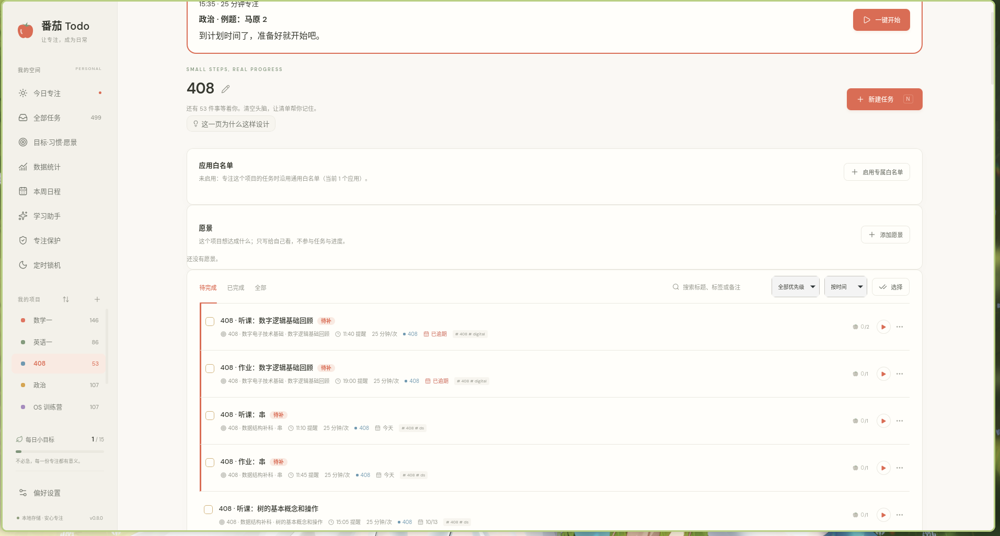
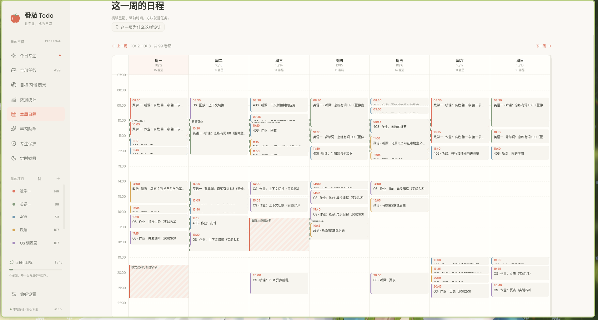
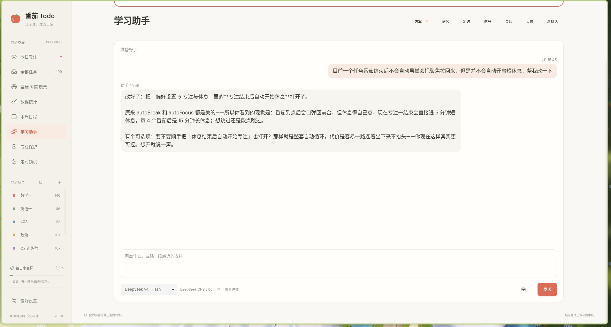
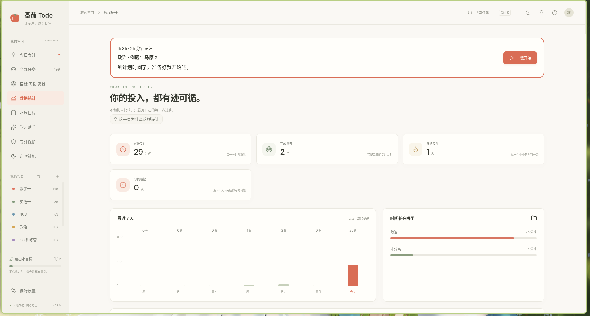
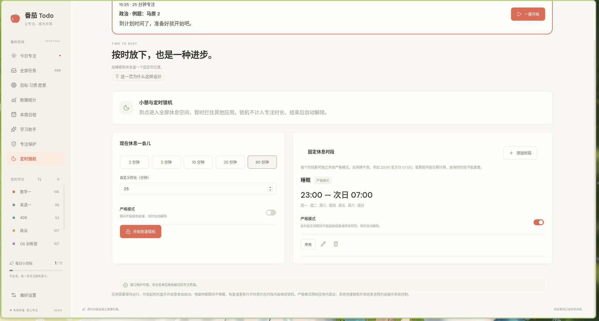
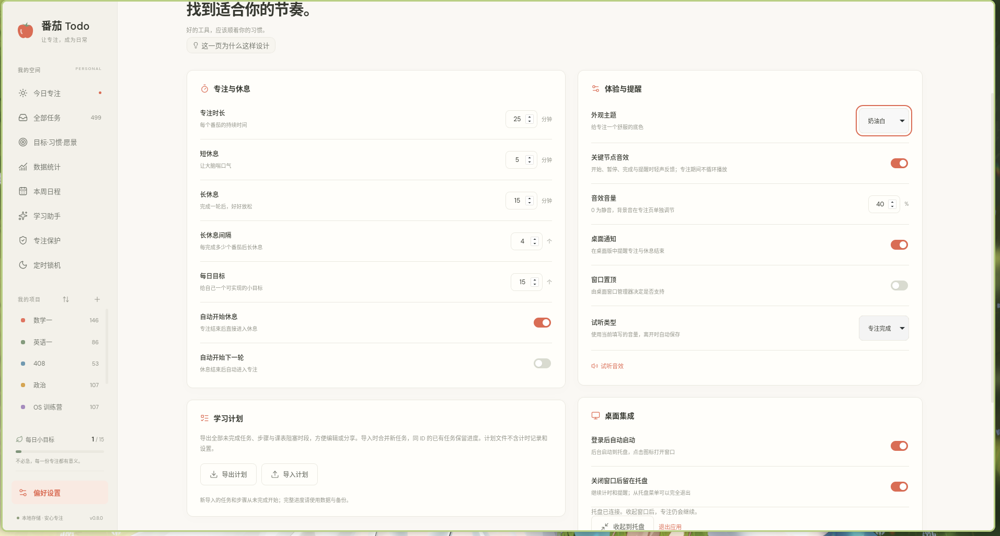

# 番茄 Todo

[](https://github.com/AntheaLaffy/tomato-todo/actions/workflows/ci.yml)
[](https://github.com/AntheaLaffy/tomato-todo/releases)
[](LICENSE)


一个以 Rust 为核心的 Linux 桌面专注工具。奶油白与番茄红界面，任务、番茄钟、统计和备份都留在本机，不依赖账号或联网。

> **不靠意志力，靠环境**：白名单把分心挡在外面，AI 帮你把环境调成你的样子。



## 目录

- [它解决什么](#它解决什么)
- [为考研而作](#为考研而作)
- [界面](#界面)
- [核心概念](#核心概念)
- [安装](#安装)
- [桌面环境适配](#桌面环境适配)
- [专注保护能做什么、不能做什么](#专注保护能做什么不能做什么)
- [数据与备份](#数据与备份)
- [文档](#文档)
- [开发与贡献](#开发与贡献)
- [路线图](#路线图)

## 它解决什么

它想解决的不是「怎么计时」，而是「怎么让专注更容易发生」。

- **环境胜过意志力。** 专注时，不在白名单里的应用会被自动切回专注界面；你不必每次都战胜自己，只需提前把环境设好。
- **日常只有两件事。** 当下（今日专注：选一件最重要的事开一个番茄）和 AI（学习助手）。目标、愿景、习惯、课表、模板这些是「任务的容器」——给助手落笔用，不是每天的功课；统计只用来回看，不是绩效评估。规划半天不动手是最常见的失败方式，所以第一次打开时软件会直接把这两件事说清楚。
- **让 AI 维护你的环境。** 学习计划、项目专属白名单、模板、目标与任务都可以交给助手：说一句「英语任务需要词典和浏览器」，它直接改好，或先给一份待审阅文件。过去几乎不值得维护的个性化配置，现在是一句话的事。
- **桌面级、躲不掉。** 登录自启动、系统托盘常驻，关掉窗口也继续计时。
- **只属于你。** 任务、统计和设置都在本机，不联网、不要账号。
- **开源，可以接着改。** 核心是 Rust，计划格式与文档公开；欢迎用智能体按自己的需求继续扩展。

## 为考研而作

番茄 Todo 最初就是为了应付考研这种**超长线、多科目、有固定课表**的备考而写的。普通番茄钟只能计时，而备考真正难的是「每天怎么排、漏了怎么办、这一轮复习有没有到位」。

- **科目即项目**：数学一、英语一、408、政治各建一个项目，各自配一条应用白名单——听网课放行播放器、背单词只留词典、做题时把娱乐挡在外面。
- **复习阶段用主线**：基础、强化、冲刺排成节点，按时间和完成情况裁定这一阶段是成功还是失败；哪一轮没跟上会被如实记下，不靠印象。
- **课表与刷题并排**：每周的课、实验登记成阻塞时段，哪天被占满、哪天能加量一目了然；水课可以标成可并行。
- **重复练习交给模板**：单词、笔记、真题按周期自动印成当天的实例，漏做进入待补队列，不用每天手动建任务。
- **节奏交给助手**：它读得到计划与投入记录，会指出安排超量或过松、习惯缺勤、深夜还在学，并帮你把计划调好。

下面截图里的项目与待办就是一套真实的考研安排，功能细节见 [文档](#文档)。

## 界面

### 今日专注

打开就是当下（见顶部截图）：左边番茄钟，右边今天与待补的任务。到点会唤出窗口并高亮任务，一键开始；正在计时、暂停或锁机时提醒自动延后。

### 任务与项目

所有任务可增删改、完成撤销、优先级、截止日期、标签、备注、子任务，支持搜索、筛选、排序与多选批量操作。任务列表用 `content-visibility` 跳过屏外布局，任务多也不拖慢滚动。



**项目**是环境维度：不同类型、不同科目的任务需要不同的应用白名单（同样是听课，英语课和编译原理课要放的软件不一样），所以专属白名单挂在项目上。



### 本周日程

每周重复的课程、实验登记成**阻塞时段**，以半透明色带铺在周历网格背景里；任务按时间落格，一眼看出哪天空、哪天过载。每个时段标成**需专心**或**水课**——需专心的时段里排专注任务会被本地诊断提示真实冲突，水课时段表示签到即可、课上能并行写作业。



### 学习助手

侧栏「学习助手」接入 DeepSeek API 或 Codex 账号（可直接复用 Codex CLI 的登录与 `config.toml` 第三方模型）。它维护你的个性化环境：把一句话落成项目、白名单、模板、目标与任务，并主动指出安排冲突、估时偏差和漏排。



怎么用：

1. **接上模型**：打开侧栏「学习助手」→ 顶栏「设置」，填 DeepSeek API Key 并勾选启用，或点「登录 Codex」复用账号；后端与模型在对话页下方选。
2. **直接说人话**：它能读你的任务、计划与投入记录，再动手改环境——新建项目、配应用白名单、加模板，或把一句话排成定时任务（「每晚 21:50 帮我约座位」）。
3. **要方案就等方案**：改动数据或文件时它先生成**待审阅**文件，你在「方案」里批准后才应用；异常自动唤醒只分析、只给建议，不直接动数据。
4. **接外部系统**：座位、图书馆这类系统可通过 MCP 服务器接入，见 [自建 MCP 服务器](docs/MCP.md)。

### 数据统计

当天专注时间、完成番茄、连续天数、近七天趋势、项目时间分布与专注历史；提前结束也保留实际用时。另有两块围绕成败的视图：**主线**给出每个目标组「整条线全部成功才算成功、任一失败即失败」的结果与逐节点时序；**纵切面**把近两周每天的完成、缺勤、作废与主线成败并排。



### 专注保护与定时锁机

在 **niri / Wayland** 上提供全屏锁定与应用白名单；每个项目可选配专属白名单，专注该项目的任务时替代通用白名单。独立的「小憩 / 定时锁机」页支持 1–720 分钟快速锁机、跨午夜的每周重复时段，到点从托盘唤回全屏休息界面，睡眠不计入学习时长。



### 偏好设置

专注/休息时长、每日目标、自动衔接、明暗主题、关键节点音效与音量、桌面集成、学习计划与备份都在这页。编辑期间不写入，离开时统一保存；窗口失焦不保存。



## 核心概念

日常的「事」叫任务；任务之外还有五种容器，分属两个轴：**执行语义**（目标、习惯）与**环境语义**（项目），外加一个不参与执行的**方向标记**（愿景）。

| 概念     | 一句话                                                                 | 更多                                       |
| -------- | ---------------------------------------------------------------------- | ------------------------------------------ |
| **任务** | 一次可执行的事；类别由管辖与时间/重复自动推导，不手填                   | 本页界面说明                               |
| **项目** | 回答「做这件事时该处在什么环境」，持有专属应用白名单                     | [设计理念](docs/DESIGN.md)                 |
| **目标** | 一组任务共享一条主线，按节点裁定成败，漏做进「待补」                     | [主线与节点设计](docs/NODE_DESIGN.md)      |
| **习惯** | 固定时间重复，过期从今日待办移出并计一次缺勤                             | [设计理念](docs/DESIGN.md)                 |
| **愿景** | 纯方向标记，不参与任务、进度与缺勤                                       | [设计理念](docs/DESIGN.md)                 |
| **模板** | 重复内容的印刷规则，自动或手动印成实例                                   | [设计理念](docs/DESIGN.md)                 |

为什么这样分、主线怎么裁定、模板怎么印刷，都在 [设计理念](docs/DESIGN.md)；具体数据字段见 [学习计划格式](docs/PLAN_FORMAT.md) 与 [备份格式](docs/BACKUP_FORMAT.md)。

## 安装

### 下载安装

在 [Releases](https://github.com/AntheaLaffy/tomato-todo/releases) 选择对应版本：

- Debian / Ubuntu：下载 `.deb` 安装。
- 其他发行版：解压 `*-x86_64-linux.tar.gz`，用其中的 `install.py` 安装到用户目录，无需 root。

```sh
tar -xzf tomato-todo-*-x86_64-linux.tar.gz
cd tomato-todo-* && python3 install.py
```

安装后程序位于 `~/.local/lib/tomato-todo/`，命令入口 `~/.local/bin/tomato-todo`，应用列表入口 `$XDG_DATA_HOME/applications/tomato-todo.desktop`（默认 `~/.local/share/applications/`）。`--autostart` 启用登录后后台启动；`--pin-dms` 为 DankMaterialShell 栏添加固定入口（改配置前会备份，重复安装不会重复添加）。

### Arch / niri（从仓库）

```sh
python3 scripts/install.py --autostart --pin-dms
```

其他桌面可省略 `--pin-dms`。使用 `--pin-dms` 后执行 `dms restart` 刷新桌面栏。

### 从源码构建

```sh
pnpm install
pnpm run desktop        # 桌面开发
pnpm run desktop:deb    # 构建生产 .deb
```

完整的构建、测试与贡献说明见 [CONTRIBUTING.md](CONTRIBUTING.md)。

## 桌面环境适配

番茄 Todo 是 Linux 桌面应用，任务、番茄钟、统计、备份等主体功能在各主流桌面环境都可用。与桌面深度耦合的两项能力——**专注保护**和**定时锁机**——目前只在 **niri / Wayland** 上完整可用，因为它们需要通过 niri IPC 获取前台窗口并把不允许的应用切回番茄 Todo。

| 桌面 / 会话                          | 任务、计时与统计 | 专注保护与定时锁机 | 托盘与自启动                        |
| ------------------------------------ | ---------------- | ------------------ | ----------------------------------- |
| **niri / Wayland**（主要验证环境）   | ✅               | ✅ 完整可用        | ✅                                  |
| 其他 Wayland 合成器（GNOME、KDE 等） | ✅               | ⚠️ 按钮显示不可用  | ✅ 需 AppIndicator / StatusNotifier |
| X11                                  | ✅               | ⚠️ 按钮显示不可用  | ✅ 需 AppIndicator / StatusNotifier |

- **niri / Wayland**：程序优先使用原生 Wayland，让窗口 PID 和应用标识能被正确识别；即使启动终端设置了 `GDK_BACKEND=x11`，也不会误用 Xwayland 中转窗口。
- **托盘**：需要 AppIndicator 运行库（Arch 的 `libappindicator-gtk3`，Debian 的 `libayatana-appindicator3-1`）及桌面上的 StatusNotifier 组件。没有托盘时正常显示窗口和退出，后台启动会等待桌面组件最多约 10 秒后显示窗口。
- **自启动**：配置为 `$XDG_CONFIG_HOME/autostart/studio.tomato.todo.desktop`；niri 会话需启用 XDG 自启动目标。仅在本机保存的桌面偏好为 `$XDG_CONFIG_HOME/studio.tomato.todo/desktop.json`，不随任务备份导入到其他电脑。
- **系统运行库**：依赖系统 GTK 3 和 WebKitGTK 4.1（Arch 为 `gtk3` / `webkit2gtk-4.1`，Debian / Ubuntu 为 `libgtk-3-0` / `libwebkit2gtk-4.1-0`）。
- **构建兼容性**：发布用 Debian 安装包在 CI 的 Ubuntu 22.04 上构建，以覆盖较旧的发行版；不保证所有发行版的旧版 glibc。

## 专注保护能做什么、不能做什么

程序通过 niri IPC 获取前台窗口并把不允许的应用切回番茄 Todo。白名单按精确 `app_id` 匹配，可直接添加当前打开的应用。浏览器内的所有网站共用一个应用标识，因此允许浏览器也会允许其中的娱乐网站。

这是**自律辅助功能**。它不会结束其他进程，不会暂停或修改其他应用；无法阻止系统快捷键、工作区总览、其他显示器的内容或外部结束进程。严格模式由 Rust 拒绝提前退出，而非只隐藏按钮；IPC 故障仍会解除当前保护并报错。尚未实现云同步、在线自习室、网站过滤或操作系统级安全锁屏。

定时锁机需要应用保持运行，可收起到托盘并开启登录自启动。电脑休眠时不唤醒，恢复或重开应用时若仍在时段内则继续锁机。星期按开始日期计算，启用的时段不允许重叠。进入睡眠时结束当前专注并保留实际用时；锁机结束不会自动重启专注。

## 数据与备份

任务、统计和设置默认只保存在本机的 SQLite：`$XDG_DATA_HOME/studio.tomato.todo/tomato.sqlite3`，未设置时位于 `~/.local/share/studio.tomato.todo/`。`TOMATO_DATA_PATH` 可指定独立数据库；预览版使用 `artifacts/preview.sqlite3`，不与正式版混用。**不要在程序运行时手动修改 SQLite**，迁移数据请用界面内的 JSON 备份。

- **学习计划**（偏好设置 → 学习计划）：导出未完成实例、模板、主线、项目与课表阻塞时段，便于编辑或分享。导入是**以文件为准的配置更新**——相同 ID 的任务、目标节点、模板、项目与阻塞时段按文件更新，完成进度、专注历史与节点裁定一律保留；文件没提到的实体默认不动，加 `"replace": true` 改为整份同步。规范见 [PLAN_FORMAT.md](docs/PLAN_FORMAT.md)。
- **完整备份**：包含严格模式、定时锁机、节点裁定、配对与永久 ID 历史。导入备份会替换当前数据，需在界面确认，并暂停导入的计时器。规范见 [BACKUP_FORMAT.md](docs/BACKUP_FORMAT.md)。

用户提供的课表和私人备考分析位于忽略版本管理的 `artifacts/planning/`，不打入程序，也没有写入默认任务数据库。

## 文档

| 文档                                             | 内容                                                       |
| ------------------------------------------------ | ---------------------------------------------------------- |
| [设计理念](docs/DESIGN.md)                        | 任务、目标、习惯、项目与愿景为什么这样分；模板印刷的取舍   |
| [主线与节点设计](docs/NODE_DESIGN.md)             | 配对、信号裁定与阻断的完整语义和实现边界                   |
| [学习计划格式](docs/PLAN_FORMAT.md)               | v5 计划文件标准、Schema 与通用示例                         |
| [完整备份格式](docs/BACKUP_FORMAT.md)             | v3 备份标准、Schema 与示例                                 |
| [学习助手与 MCP](docs/AGENT.md)                   | 后端与登录、异常自动唤醒、权限与记忆、MCP 接入             |
| [自建 MCP 服务器](docs/MCP.md)                    | 给自己写一个 MCP 服务器并挂进助手                          |
| [CODEMAP.md](CODEMAP.md)                          | 按任务与目录的代码导航地图                                 |

## 开发与贡献

需要 Rust stable、Node.js 22.12+、pnpm、系统 GTK 3 / WebKitGTK 4.1 开发库、C 编译工具链和 pkg-config。快速上手：

```sh
pnpm install
pnpm run dev            # Rust 服务 + Vite 浏览器预览
pnpm run check          # TypeScript + Rust Clippy
pnpm test               # Rust 单元测试 + 浏览器端到端测试
```

Rust 负责状态机、任务规则、数据校验、SQLite、统计和桌面保护；TypeScript 只负责视图、交互与本地声音。核心库由 Tauri 和 Axum 预览服务共享，避免预览与桌面产生两套业务逻辑。

提交前请读 [CONTRIBUTING.md](CONTRIBUTING.md)：命令、架构、隔离桌面测试约束与提交信息规范都在那里。

## 路线图

学习助手已经落地，见 [学习助手与 MCP](docs/AGENT.md)。**稳定版 1.0.0 的验收条件是外观、功能、性能三项都通过**（外观成套统一、功能闭环实测、性能达标）；在那之前只发 0.x 小版本。以下是尚未实现的方向，欢迎一起补齐：

- **网站级过滤与系统级安全锁屏**：白名单按应用匹配，浏览器内所有网站共用一个标识；保护也不阻止系统快捷键或外部强杀。
- **云同步与在线自习室**：任务、统计与设置默认只保存在本机。

## 许可

[MIT](LICENSE)。字体 DM Sans 随应用打包，许可见 [public/fonts/OFL.txt](public/fonts/OFL.txt)。
